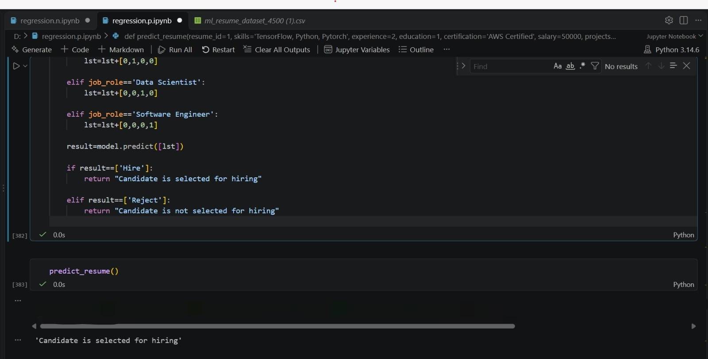

AI Resume Screening Using Machine Learning

1. Project Overview

The AI Resume Screening System is a machine learning-based project developed to automate the resume screening process. It analyzes candidate information and predicts candidate suitability using machine learning techniques.

2. Project Objectives

- Automate the resume screening process.
- Analyze candidate skills and experience.
- Evaluate candidates using machine learning.
- Predict candidate suitability.
- Reduce manual recruitment effort.

3. Features

- Candidate information analysis.
- Skills and experience evaluation.
- Certification analysis.
- AI-based candidate scoring.
- Hire/Reject prediction.
- Data visualization.
- Model performance evaluation.

4. Technologies Used

Technology| Purpose
Python| Programming language
Pandas| Data manipulation
NumPy| Numerical operations
Matplotlib| Data visualization
Scikit-learn| Machine learning
Imbalanced-learn| SMOTE
Joblib| Model saving
Jupyter Notebook| Development environment

5. Machine Learning Techniques

- Label Encoding: Converts categorical values into numerical values.
- Train-Test Split: Divides the dataset into training and testing sets.
- Logistic Regression: Used for classification and prediction.
- SMOTE: Handles imbalanced data.
- Confusion Matrix: Evaluates classification performance.

6. Dataset Description

The dataset contains the following columns:

- Resume ID
- Skills
- Experience (Years)
- Certifications
- Salary Expectation ($)
- Projects Count
- AI Score (0-100)

7. Project Structure

AI-Resume-Screening/
│
├── AI_Resume_Screening.ipynb
├── AI_Resume_Screening.csv
├── requirements.txt
├── README.md
│
└── Screenshots/
    ├── cover.png
    ├── dataset.png
    ├── prediction_code.png
    ├── prediction_output.png
    └── results.png

8. Installation Requirements

Install the required Python libraries:

pip install pandas numpy matplotlib scikit-learn imbalanced-learn joblib

1. Clone or download the repository.
2. Open the project folder in VS Code.
3. Install the required libraries.
4. Open the Jupyter Notebook.
5. Load the dataset.
6. Run the notebook cells.
7. Enter candidate details.
8. View the prediction result.
9. How to Run the Project
10. Project Purpose
11. Author

This project demonstrates the application of machine learning in recruitment. It helps analyze candidate information and predict suitability through a classification model.

GitHub: "priyankundarpriya-cmyk" (https://github.com/priyankundarpriya-cmyk)

---

Developed as an academic machine learning project.
## Project Screenshots

### 1. Project Cover

### 2. Dataset

### 3. Prediction Code

### 4. Prediction Output

### 5. Confusion Matrix

## Author
*Priya N kundar*
BCA Final Year Student
